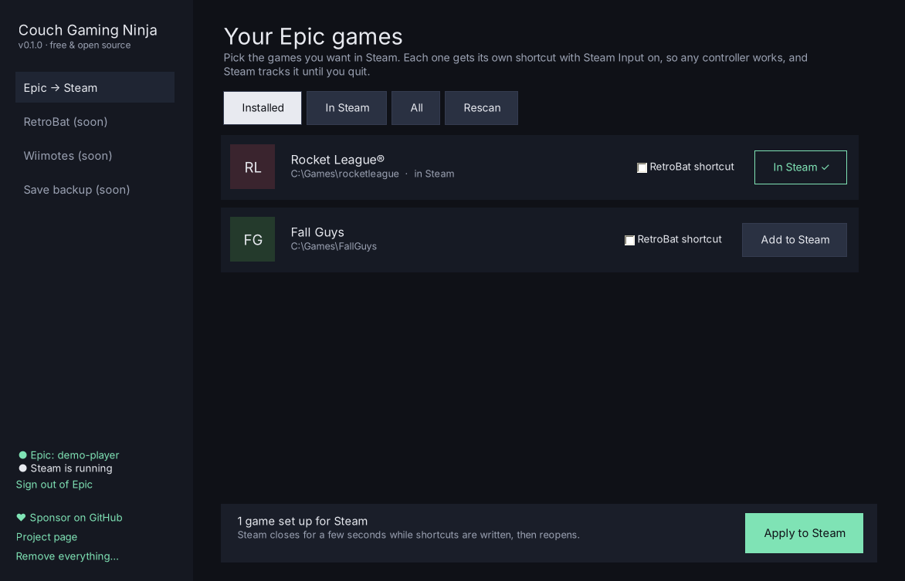

# Couch Gaming Ninja

**Play your Epic games from Steam, with any controller.** Windows only for now.

Couch Gaming Ninja adds your Epic Games Store games to Steam so that **Steam Input works** (Switch Pro, PlayStation, 8BitDo and more), the Steam overlay works, and Steam shows the game as running until you quit. Optionally it also puts a shortcut in **RetroBat**.

No Epic Games Launcher or Heroic has to stay open, and nothing runs in the background.



## Why

The usual ways to get an Epic game into Steam break Steam Input:

- **Adding the Epic Launcher to Steam:** Steam hooks the launcher, not the game.
- **Heroic's "Add to Steam":** if Heroic is already running, the new Heroic process hands the launch to the running one and exits, so Steam thinks the game closed.

Couch Gaming Ninja's shortcut runs a hidden PowerShell that launches the game with [Legendary](https://github.com/derrod/legendary) and waits until the game's own process exits. Steam tracks that whole session.

## How to use

1. Download `CouchGamingNinja.exe` from [Releases](../../releases).
2. Run it and pick **where the app should live** (see below). It copies itself there and reopens from there.
3. Click **Sign in with Epic Games**. It downloads Legendary (about 8 MB) and opens Epic's own sign-in window.
4. Click **Add to Steam** on the games you want, then **Apply to Steam**. Steam closes for a few seconds and reopens.
5. In Steam: Settings → Controller, make sure support is on for your controller type.

Games already installed by the Epic Games Launcher or Heroic are found and imported without downloading anything. Installed somewhere else? Use **Locate folder…**.

**Windows SmartScreen** may warn the first time, because the app isn't code-signed. Click *More info → Run anyway*. The source is all here.

### Where the app lives

Everything goes in **one folder**: the app itself, Legendary, your Epic session, settings and backups. On first run you choose:

- **Recommended:** `%LOCALAPPDATA%\CouchGamingNinja`
- **Portable:** a `CouchGamingNinja` folder next to the `.exe` you downloaded
- **Another folder**, for example `D:\CouchGamingNinja`

Program Files isn't offered: Windows only lets administrators write there, and Steam starts games without administrator rights, so the Epic sign-in couldn't be saved.

The app can add itself to the **Start menu**. **Move app folder…** moves everything later and points the Steam shortcuts to the new place. If the folder is deleted by hand, the Steam shortcut says so instead of silently doing nothing; open the app, sign in and press **Apply to Steam** to repair.

Running a newer `CouchGamingNinja.exe` from anywhere updates the copy in the app's folder.

### RetroBat

Tick **RetroBat shortcut** and pick your RetroBat folder (it finds `C:\RetroBat`, `C:\Games\RetroBat` and the same on other drives by itself). A `.url` per game goes into `roms\windows`. RetroBat waits for the game to close by itself.

If RetroBat **already has a shortcut with the same name** that this app didn't make, it asks first: replace it (a backup is kept and put back on removal), keep both, or leave RetroBat as it is. Files the app writes are marked with a `[CouchGamingNinja]` section.

## Good to know

- **Game updates:** this version doesn't download updates. Keep updating your games the way you do now (Epic Games Launcher or Heroic); the Steam shortcut keeps working. In-app updates are planned.
- **Your own Steam shortcuts are never touched.** The app only edits shortcuts it tagged "Couch Gaming Ninja", and backs up `shortcuts.vdf` and `localconfig.vdf` before every change.
- **Remove everything…** takes the app's shortcuts out of Steam and RetroBat, puts back any RetroBat file it replaced, signs out, removes the Start menu entry and deletes the app's folder. Your games are never touched.
- **Epic session:** if you don't play for a long time, Epic may ask you to sign in again. Open the app and sign in.
- Uses **Legendary 0.20.34** on purpose: 0.21.1's sign-in window fails on Windows (`pythonnet` / Python 3.14).

## Roadmap

- RetroBat: start RetroBat from Steam at Windows startup
- Wiimotes in RetroBat without a second controller
- Save-game backups off the system drive
- Game updates from inside the app
- Linux / SteamOS

## Credits

- **[Legendary](https://github.com/derrod/legendary)** by derrod and contributors: the open-source Epic Games client that does the Epic side. Downloaded at first run, not bundled.
- **[Slipstream](https://github.com/jun-eau/Slipstream)** by jun-eau: a Rocket League launcher that inspired this project. If you're on Linux or Steam Deck, check it out.

Not affiliated with Epic Games, Valve or RetroBat.

## Support

Free, no ads, no tracking. If it saved you an evening, you can [sponsor on GitHub](https://github.com/sponsors/Colchoens).

## Build

```
sudo apt install mono-devel   # or Mono on macOS / Windows
./build.sh                    # runs the tests, writes dist/CouchGamingNinja.exe
```

Targets .NET Framework 4.8, which ships with Windows 10 and 11.

## License

MIT
